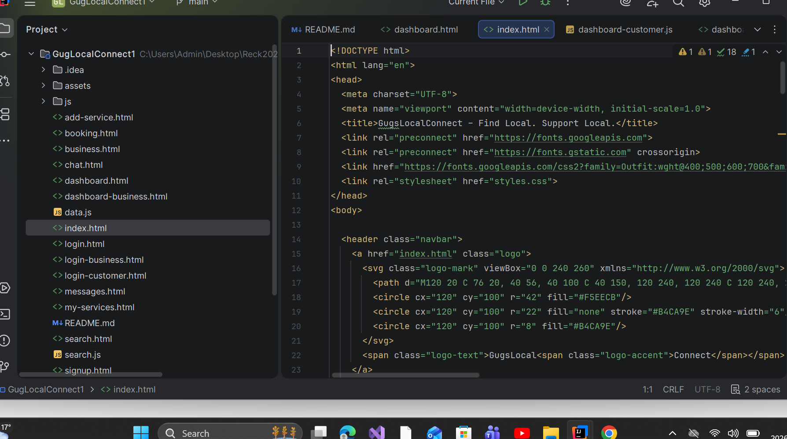
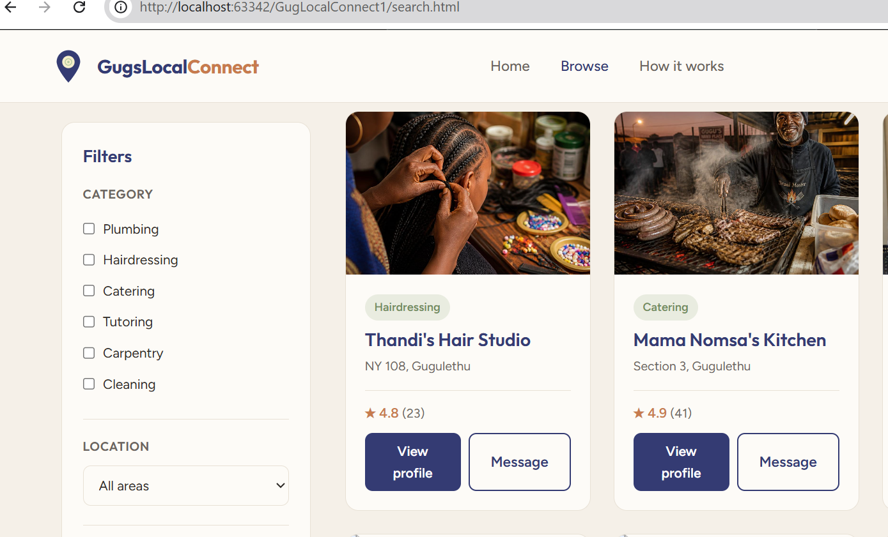
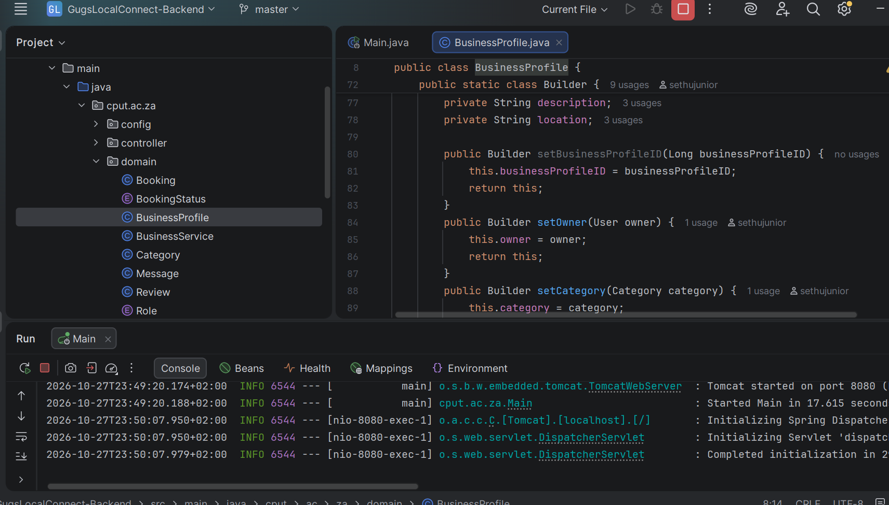
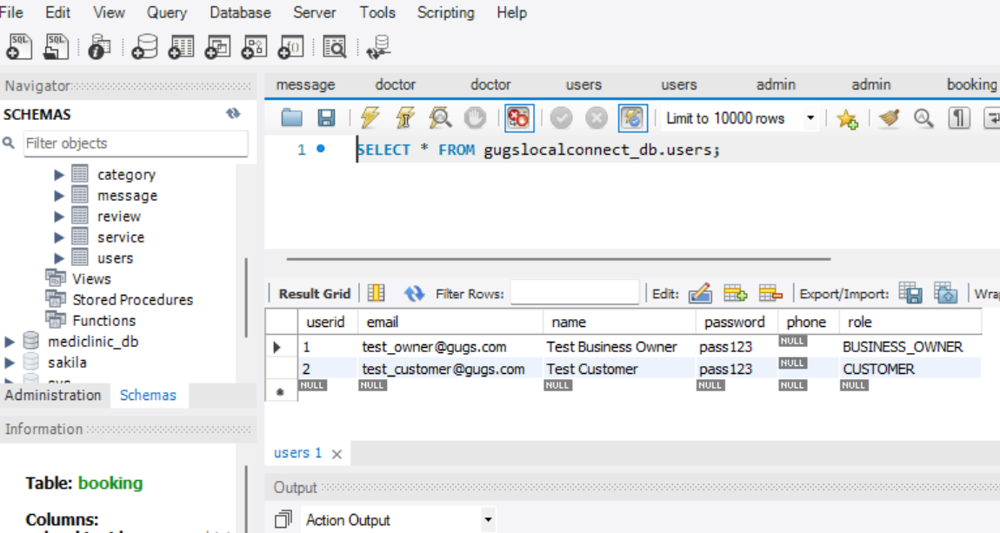

# GugsLocalConnect - Digital E-Portfolio (PRP370S / PFP362S)

Welcome to the official digital e-portfolio for **GugsLocalConnect**, a community-focused web platform connecting residents of Gugulethu, Cape Town, with trusted local businesses and independent service providers[cite: 5].

---

## 👥 Project & Team Details
* **Course:** Professional Practice 3 / Project Presentation 3 (Cape Peninsula University of Technology)[cite: 5]
* **Group:** Group 3 (3G)[cite: 5]
* **Group Members:** Bongikazi Malebu Mnyamana, Sethu Mdluli, Phelo Mguca, Siyalezo Mbuyisa, Lethabile Lalela, Matuma Malapile[cite: 5]

---

## 📋 Table of Contents
1. [Agile Team Charter](#1-agile-team-charter)
2. [User Stories and Tasks](#2-user-stories-and-tasks)
3. [Product Backlog](#3-product-backlog)
4. [Sprint Backlog](#4-sprint-backlog)
5. [Agile Logbook](#5-agile-logbook)

---

## 1. Agile Team Charter

### Evidence
* **Shared Purpose:** To build a two-sided platform enabling Gugulethu residents to easily search, browse, and book trusted local service providers (hairdressers, barbers, plumbers, tutors, mechanics, caterers) while helping small business owners gain visibility[cite: 5, 11].
* **Working Agreements:** Standardized project structure, GitHub branch management rules, and daily stand-ups to maintain smooth team execution[cite: 12, 13, 14].

*Figure 1.1: Frontend Repository Structure & HTML Scaffolding (index.html, dashboard, search components)[cite: 16, 21]*

### Reflection
* **Structured Reflection (Collect-Select-Reflect-Connect):** Establishing our team charter during Sprint 1 reduced friction and aligned our execution goals[cite: 4, 12]. By defining our technical stack (Angular, Spring Boot, PostgreSQL) early, team members took ownership of specific layers while maintaining shared coding standards[cite: 5, 6, 14].

---

## 2. User Stories and Tasks

### Evidence
* **Customer User Story:** *"As a customer, I want to search and browse local service providers so that I can find trusted services easily."*[cite: 12]
* **Business Owner User Story:** *"As a business owner, I want to create a profile and advertise my services so that I can reach more customers."*[cite: 12]

*Figure 2.1: Live Application Interface — Customer Search & Filter UI (Thandi's Hair Studio, Mama Nomsa's Kitchen)[cite: 18, 21]*

### Reflection
* **Structured Reflection:** Translating high-level user stories into functional web components allowed us to design a responsive UI tailored for Gugulethu residents[cite: 5, 18]. The search/filter interface addresses the core community need identified in our initial survey (where 85% of residents stated they would use an online platform to find local services)[cite: 5, 18].

---

## 3. Product Backlog

### Evidence
* **Core Backlog Items:** Managed via Trello, prioritizing features such as search functionality, category filtering, contact business features, unit/integration testing, performance optimization, and final deployment[cite: 19].

*Figure 3.1: Product Backlog Board — Task Breakdown and Feature Prioritization[cite: 19, 21]*

*Figure 3.2: Spring Boot Backend Architecture — Domain Models & Embedded Tomcat Service[cite: 17, 21]*

### Reflection
* **Structured Reflection:** Using a critical framework, we prioritized core directory, booking, and messaging capabilities over automated payment processing[cite: 8, 11]. Since GugsLocalConnect acts as a discovery and trust platform, transactions are handled directly off-platform via channels like WhatsApp and cash, matching local township business practices[cite: 8, 11].

---

## 4. Sprint Backlog

### Evidence
* **Sprint Objectives:** Execute database migrations, build Spring Boot API endpoints, design UI dashboards, develop login pages, and link frontend pages with backend controllers[cite: 14, 17, 20].

*Figure 4.1: Active Sprint Kanban Board — Executed Tasks (Dashboard Design, Login, Frontend-Backend Integration)[cite: 20, 21]*

*Figure 4.2: Database Execution — `gugslocalconnect_db.users` Schema Query showing Role-Based Access Control (`BUSINESS_OWNER` & `CUSTOMER`)[cite: 15, 21]*

### Reflection
* **Structured Reflection:** Managing a real-time sprint backlog allowed us to tackle technical bottlenecks as they arose—such as mapping entity relationships, setting up Row Level Security (RLS) constraints, and verifying JSON response payloads[cite: 6, 14, 17].

---

## 5. Agile Logbook

### Evidence
* **Daily Stand-up Activity Log (July 2026):**
  * *14 July:* Aligned on supervisor presentation materials and confirmed technical stack requirements[cite: 12, 13].
  * *15–16 July:* Delivered project presentation to supervisor and incorporated feedback into technical workflow[cite: 13].
  * *17–21 July:* Segmented backlog user stories into developer task breakdown and initialized GitHub repository[cite: 13, 14].
  * *22–24 July:* Created entity models, configured controllers (`BusinessProfile.java`), and tested HTTP POST/GET endpoints[cite: 14, 17].

### Reflection
* **Structured Reflection:** Consistently updating our daily stand-up logbook and tracking task flow on Trello created a transparent, verifiable timeline of our group's technical progress[cite: 3, 4, 12, 19, 20]. This iterative process connected academic requirements directly with practical software delivery[cite: 3, 14, 16, 17].
